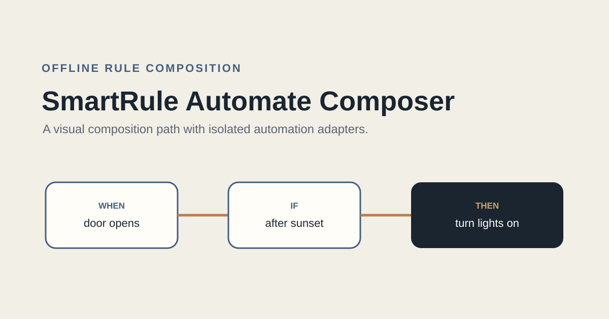
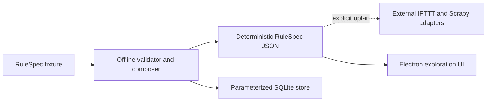

# SmartRule-Automate-Composer

SmartRule-Automate-Composer converts a small IoT automation description into a deterministic RuleSpec document and preserves composed rules locally. It also retains experimental Electron, Scrapy, and Selenium adapters for investigating external automation services.

This repository is a rule composer. The grammar file under `monitor_grammer/` is a design example; there is no implemented grammar parser in the current codebase.

## Offline-first path

The supported local path uses only the Python standard library and does not make network requests:

```bash
python3 -m applet_executor.offline_composer tests/fixtures/rule-spec-v0.json
python3 -m unittest discover -s tests
```

The adapter accepts exactly one trigger, zero or one condition, and exactly one action. Each step has two string fields: `device` and `state`. The result adds `"schema": "rule-spec/v0"` and emits stable, sorted JSON.

## Architecture



The offline composer and SQLite store are the maintained demonstration path. External adapters are isolated behind explicit environment configuration and remain disabled by default.

### SQLite persistence boundary

On a new database, the store creates the current `rule_table` schema. On an existing database, it opens the table only when the column contract already matches. A legacy or otherwise mismatched schema fails closed with explicit backup and migration guidance; the implementation does not drop, rename, or rewrite the table, and existing rows remain untouched. Automatic compatibility with historical schemas is not claimed.

## External adapter configuration

Copy `.env.example` into an untracked environment source and set `IFTTT_ADAPTER_ENABLED=true` only when intentionally testing against an account you control. Missing email, password, or authorization values cause an explicit error. Unit tests never enable this adapter and never call external services.

## Electron build

Prerequisite: Node.js 22.12 or newer.

```bash
cd electron_gui
npm ci
npm test
```

The Electron application remains an experimental data-selection interface. It expects catalog JSON files produced by the legacy Scrapy data acquisition path. Catalog modules are loaded only from that fixed local data root after allowlist and real-path containment checks.

The UI targets Electron `41.10.6`. Its window explicitly enables context isolation and renderer sandboxing, disables Node.js integration, denies new-window requests, and accepts privileged IPC only from its owned local page. The filter-code input is a dependency-free native text area; syntax highlighting is intentionally unavailable.

## Current boundaries

- RuleSpec v0 currently supports a single trigger/action pair and at most one condition.
- The grammar example is documentation only; it is not parsed or executed.
- Scrapy spiders depend on upstream page and GraphQL shapes that can change without notice.
- Selenium execution is an opt-in experimental adapter, not a production automation API.
- TypeScript compilation and the hardened window policy are verified, but a packaged desktop launch still requires platform-level smoke testing with the Electron binary and representative catalog fixtures.
- No end-to-end claim is made between this repository and the other IoT repositories until the shared contract harness is published.

## License status

The Electron package declares ISC in its package metadata, but the repository has no top-level license file. Treat the repository as unlicensed until the owner selects and adds a repository-wide license.
