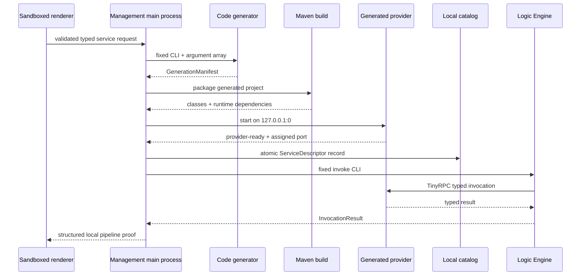

# Architecture

## Boundaries

`electron_gui` owns the trusted local application boundary. Its main process validates
requests and launches only fixed, repository-owned adapters. The renderer cannot name a
Java class, alter a classpath, submit Java source, or interpolate a shell command.

`services/code-generator` owns source generation. It uses a staging directory, validates
all identifiers and typed literals, and atomically reserves a new project directory.
Its `GenerationManifest` records template and output hashes without a host path.

The generated project owns one typed provider process. A constant template returns one
validated literal. The fixed `STATEFUL_BOOLEAN_DEVICE_V1` template owns a synchronized
boolean and successful-action counter in that same process; it exposes only three
zero-argument operations. Maven compiles it and copies its
runtime dependency closure. The process binds only to loopback on an operating-system
assigned port. Management records the announced endpoint in an atomic local catalog,
then calls the fixed Logic Engine CLI, which invokes the provider through TinyRPC.

## Failure behavior

- An invalid or unknown request field fails before source generation.
- Existing projects and concurrent writers produce a conflict; files are not merged.
- A render failure removes the staging directory.
- Build output is capped and the process has a deadline.
- A provider that does not emit one valid `provider-ready` line is terminated.
- Catalog publication occurs only after provider readiness.
- Invocation failure terminates the provider and is returned as an error.
- Stateful handlers reject non-empty arguments before mutation; unknown operations are
  unregistered, and both paths leave the action counter unchanged.
- External adapters remain off during generation and packaged self-checks.

## Packaging

The unpacked packager uses only Node built-ins. It copies the installed host Electron
distribution, validates symlinks, removes only the default demo app, and installs the
reviewed production closure under the standard `resources/app` location. Electron and
Chromium license files, locales, resources, and native runtime names are preserved.
The package manifest hashes the delivered runtime tree and identifies the exact source
commit, Electron version, host OS, and architecture.
